# Mods for Probably Stolen

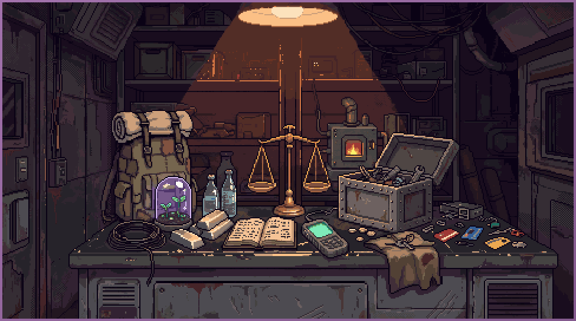

By RnK Gaming. Each mod works on its own unless it says what it needs.

Found a bug, or have an idea? Open an [issue](https://github.com/rnk-gaming/probably-stolen-mods/issues). That is where I keep track of things.

## Off the Books

### The mods

| | |
|---|---|
| [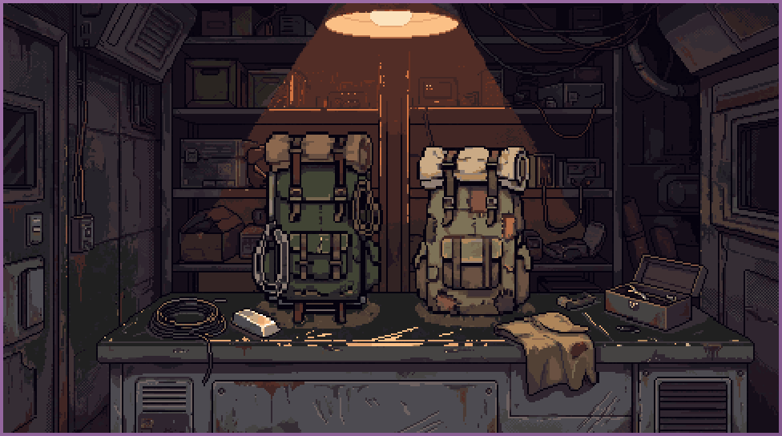](mods/Backpacks/README.md) | **[Off the Books: Backpacks](mods/Backpacks/README.md)** 1.6.0 Upgrade backpacks with materials: size, compartments, side bags and a toolbox slot. Adds two backpacks and two starting perks. Needs: Nothing. |
| [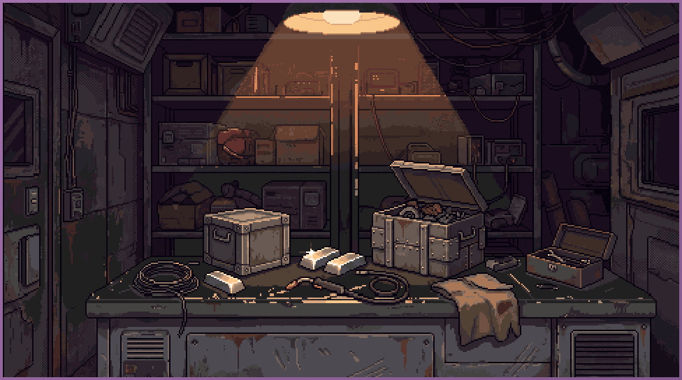](mods/StorageUpgrades/README.md) | **[Off the Books: Storage Upgrades](mods/StorageUpgrades/README.md)** 1.3.4 Enlarge storage bays, loot crates, Red Imp Beer Cases and machine storage with materials. Needs: Nothing. |
| [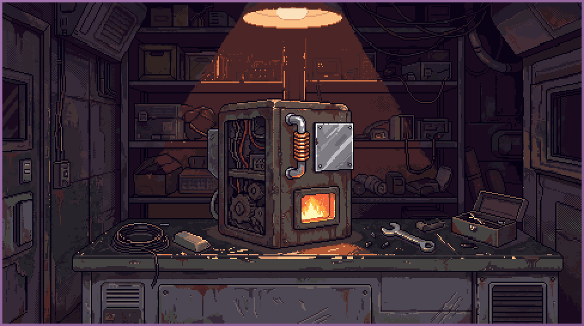](mods/MachineUpgrades/README.md) | **[Off the Books: Machine Upgrades](mods/MachineUpgrades/README.md)** 3.1.2 Upgrade eight machines by dropping the game's own materials on them. Needs: Nothing. Skips the Integrated Farm of Probably a Farm Story when that mod runs. |
| [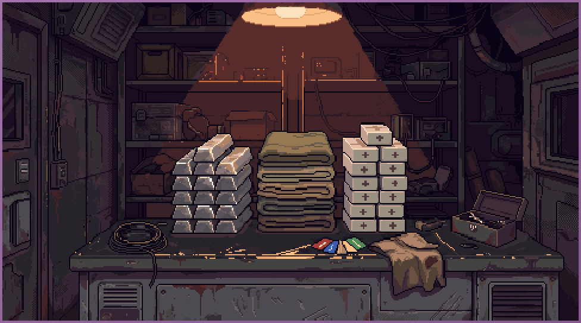](mods/Stacking/README.md) | **[Off the Books: Stacking](mods/Stacking/README.md)** 1.9.2 Stack materials, medical items and key cards, with a limit for each kind of goods. Needs: Nothing. Works with Station Economy and Faucet Filter when they run. |
| [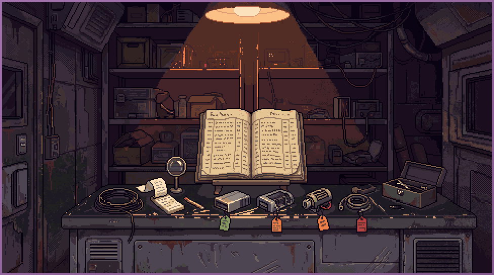](mods/ShopkeepingSuite/README.md) | **[Off the Books: Shopkeeping Suite](mods/ShopkeepingSuite/README.md)** 0.7.2 Aids for running the shop: marks on items, tooltip lines, a ledger of the day's money and a window with four pages. Needs: Nothing. Reads Station Economy, Scrapyard Expansion and Module Forge when they run. |
| [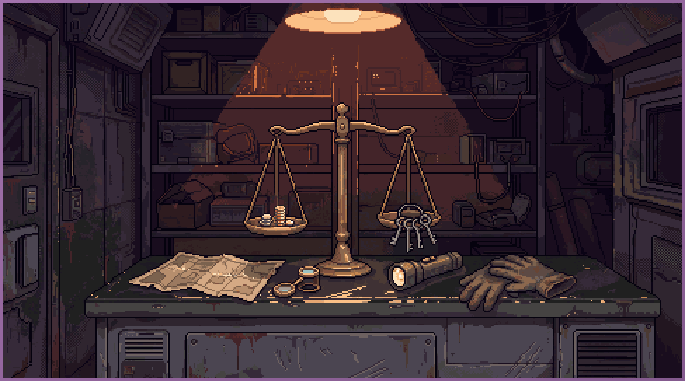](mods/Perks/README.md) | **[Off the Books: Perks](mods/Perks/README.md)** 0.2.2 29 starting perks for the new-game screen, with drawbacks that give points back. Needs: Nothing. |
| [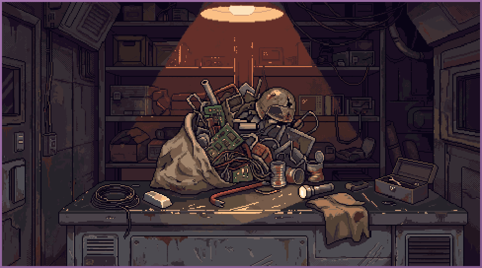](mods/ScavengingPool/README.md) | **[Off the Books: Scavenging Pool](mods/ScavengingPool/README.md)** 2.1.2 All of a night's scavenging attempts in one pool, for one visit to the dumping ground. Needs: Nothing. Counts Transit Quota's trips when that mod runs. |

### Tweaks for other mods

| | |
|---|---|
| [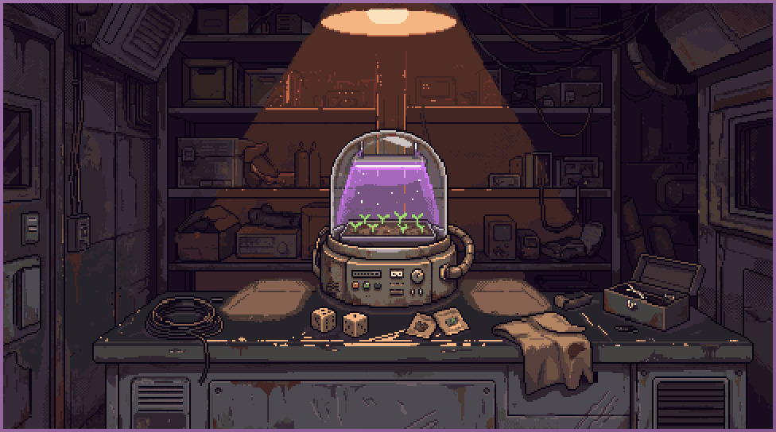](mods/FarmStoryTweaks/README.md) | **[Off the Books: Probably a Farm Story Tweaks](mods/FarmStoryTweaks/README.md)** 3.0.0 The machines of Probably a Farm Story appear in vendor stock by chance instead of on every visit. Needs: Probably a Farm Story. |

### Compatibility

| | |
|---|---|
| [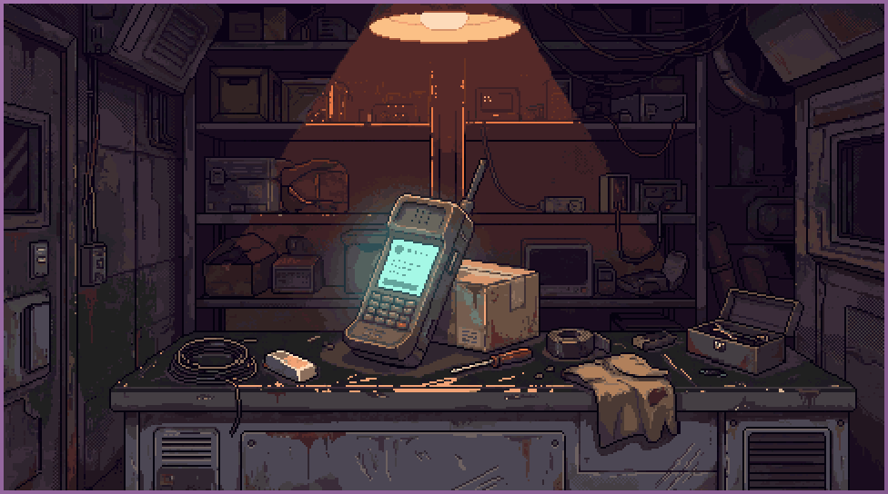](mods/StationEconomyCompat/README.md) | **[Off the Books: Station Economy Compatibility](mods/StationEconomyCompat/README.md)** 2.6.2 Corrects Station Economy's phone on wide screens, its texts, its English, its Furnace feed and its whole-lot offers, in memory. Needs: Station Economy. |
| [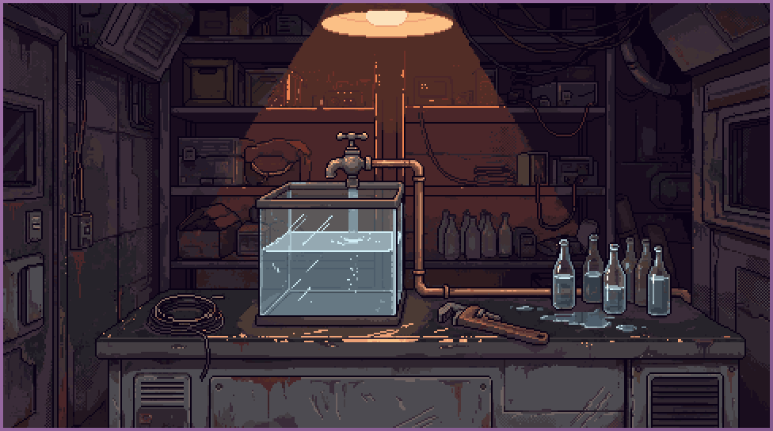](mods/ShelfCompat/README.md) | **[Off the Books: Water Expanded Compatibility](mods/ShelfCompat/README.md)** 1.1.4 Lets Water Expanded's devices work on Shop Expansion's shelves and in the back room. Needs: Water Expanded; Shop Expansion for the shelves. |

## Install

Subscribe to a mod on the Steam Workshop and Steam does the rest. Then approve the mod and switch it
on in the game's Mods menu, and restart the game.

## How they are made

These mods are built with help from AI tools. The ideas and the decisions are mine, and I play with all of them myself.

## Licence

MIT, see [LICENSE](LICENSE).
