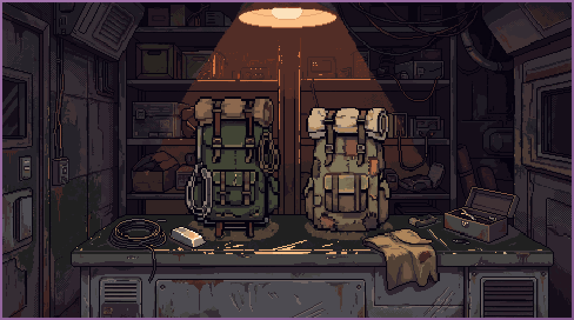

# Off the Books: Backpacks

Your backpack can grow. Drop materials on it and it gets bigger, gets compartments, side bags and a slot for a toolbox.

| | |
|---|---|
| Mod id | `rnk.backpacks` |
| Version | 1.8.0 |
| Needs | Nothing. |

## What you get

- **Bigger:** Kotton Fabric and 3D Printing Filament add rows and width. The sizes are below.
- **Compartments:** drop a smaller, empty bag on a backpack and it becomes an extra page.
- **Side bags and a toolbox slot:** small bags hang on the outside and can be taken off again. The first side bag slot costs 2 Wire and 1 Metal Screws, the toolbox slot 1 Metal Ingot and 2 Scrap Metal.
- **Stack size:** four steps, paid in Wire, Metal Screws and a Metal Ingot.
- **Two new packs:** the Scavenger's Pack (6x9, grows to 16x9) and the Hauler's Pack (7x11, grows to 17x11). They are rare. Dr. Jackson has the first from day 20 and the second from day 40, a couple of visits in a hundred, and with luck one turns up at the Dumping Grounds or with a scavenger.
- **Two starting perks** that put one of the packs in your hands on day one.
- **Tabs:** hold a dragged item over a compartment tab to flip to it, and drop it there.

## The backpacks

- **Fanny Pack:** 3x3, grows to 5x5.
- **Satchel (Small):** 6x3, grows to 8x5.
- **Kid's Backpack:** 5x5, grows to 7x7. Takes a Fanny Pack as a compartment.
- **Kid's Backpack (Large):** 5x6, grows to 8x8. Takes a Fanny Pack.
- **Backpack (Small):** 6x6, grows to 9x9. Takes a Fanny Pack.
- **Backpack (Basic):** 6x9, grows to 12x9. Takes a Satchel (Small), then a Backpack (Small).
- **Backpack (Large):** 8x9, grows to 15x9. Takes a Backpack (Small), a Backpack (Basic), a Module Bay Expansion Kit and a Storage Bay Expansion Kit.
- **Scavenger's Pack:** 6x9, grows to 16x9. Compartments as the Backpack (Basic).
- **Hauler's Pack:** 7x11, grows to 17x11. Compartments as the Backpack (Large).

## Options

In the Mods list and in Options, under **Off the Books: Backpacks**. Each kind of upgrade has its own switch, and you can turn the chances for the new packs up or down, from none to three times as often.

## Good to know

- The extra space is saved in your save. Before you remove the mod, use "Before removing this mod: list what to move" in Options. What sits in the extra space is gone at the next load otherwise.
- Stack size on a backpack has an effect when you also run a mod that stacks items, such as [Off the Books: Stacking](https://steamcommunity.com/sharedfiles/filedetails/?id=3846399246).
- Works on its own.

## Other mods

- **Compatible with** [Off the Books: Stacking](https://steamcommunity.com/sharedfiles/filedetails/?id=3846399246): the stack size upgrade decides how high a stack may go inside the backpack.
- **Compatible with** [Off the Books: Stacking](https://steamcommunity.com/sharedfiles/filedetails/?id=3846399246) and [Station Economy](https://steamcommunity.com/sharedfiles/filedetails/?id=3838352344): both let materials stack. Drop a stack of material on a backpack and it takes one upgrade step after another until the stack runs out or the backpack is done.
- **Not compatible with** another mod that changes the size of backpacks or adds compartments to them.
- Want to try it with another mod? Make a copy of your save first, and tell me on GitHub how it went.

The full player's guide is [dist/README.txt](dist/README.txt).

## Install

Subscribe on the [Steam Workshop](https://steamcommunity.com/sharedfiles/filedetails/?id=3846397093) and Steam does the rest. Approve the mod and switch it on in the game's
Mods menu, then restart the game.

## Problems and ideas

Open an [issue](https://github.com/rnk-gaming/probably-stolen-mods/issues). That is where I keep track of things.
