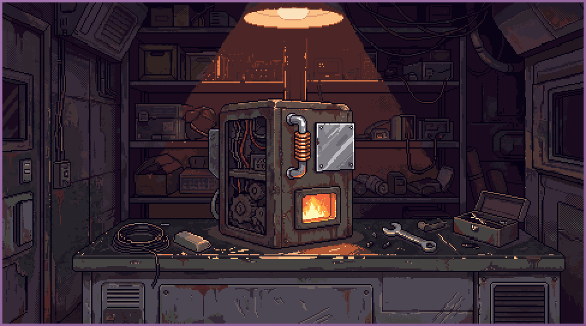

# Off the Books: Machine Upgrades



Eight machines, and all of them can get better. Drag materials onto a machine, the way you already upgrade the Fridge.

| | |
|---|---|
| Mod id | `rnk.machine-upgrades` |
| Version | 3.1.2 |
| Needs | Nothing. Skips Agri Expansion's Integrated Farm when that mod runs. |

## What you get

- **The machines:** Furnace, 3D Printer, Hydroponic System, Moisture Farm, Water Purifier, Evaporator, Cryptographic Desequencer and Chem Finisher.
- **Storage:** one Metal Ingot, one more row, up to 12 rows.
- **Efficiency:** Electronic Parts (Common), 5% a step, 40 steps, so 200% at the top.
- **Performance:** Wire, 5% or 10% a step depending on the machine.
- **Quality:** each machine has its own material. Advanced Flux Agent for the Furnace, Gun Parts for the 3D Printer, Water Filters for the water machines. A Water Purifier at 200% gives 100% pure water.
- **Furnace batches:** drop an empty Furnace on a Furnace for one more batch a night, five at most.
- **Desequencer copies:** up to four of each finished card.

## Options

In the Mods list and in Options, under **Off the Books: Machine Upgrades**. There is one switch: whether a dropped stack upgrades as far as it reaches, or one step per drop.

## Good to know

- Upgrades change what a machine makes, what it is worth and what it uses. Each storage row costs one energy a night, and that stays on the machine if you remove the mod later.
- Empty the extra rows before you remove the mod.
- Works on its own, with the game's own materials.

The full player's guide is [dist/README.txt](dist/README.txt).

## Install

Subscribe on the Steam Workshop, or copy the contents of `dist/` into a folder of its own under the
game's `Mods/` folder. Approve the mod and switch it on in the game's Mods menu, then restart the game.

## Build

```bash
dotnet build mods/MachineUpgrades -c Release
```

The DLL lands in `bin/Release/netstandard2.1/`. The folder `dist/` holds the released build.

## Problems and ideas

Open an [issue](https://github.com/rnk-gaming/probably-stolen-mods/issues). That is where I keep track of things.
