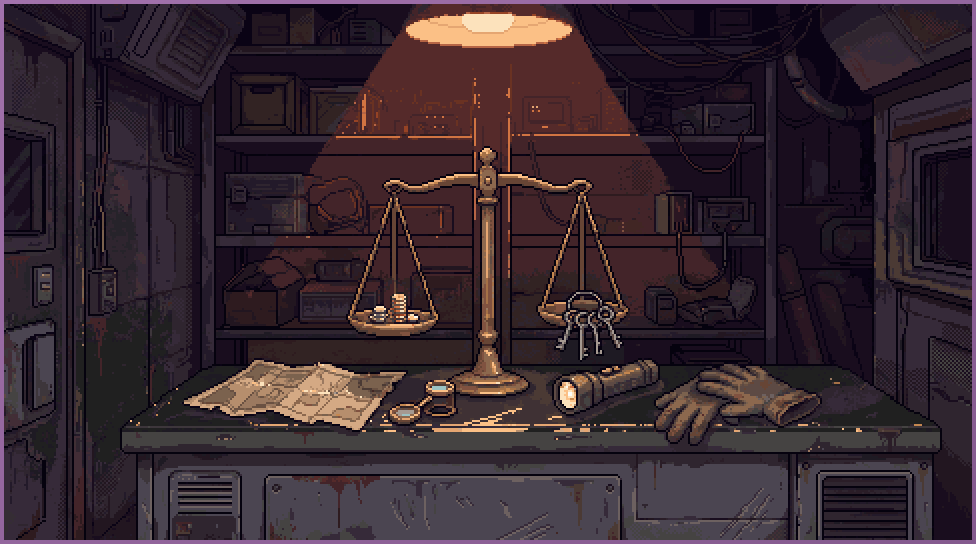

# Off the Books: Perks

29 starting perks for the new-game screen.

| | |
|---|---|
| Mod id | `rnk.perks` |
| Version | 0.2.2 |
| Needs | Nothing. |

## What you get

- **Trading:** Trusted Wholesaler makes suppliers charge 10% less. Hard Bargainer makes asking for 10% or less always work.
- **Appraisal:** Master Valuer pays you 25% more for appraisals.
- **Customers:** Private Viewing brings a luxury buyer once a week with twice the usual budget. Window Dresser makes a stocked showcase worth 50 more attraction.
- **Nights out:** Night Owl gives three outings a night.
- **Drawbacks:** nine perks that make life harder and give points back, such as Shabby Front and Marked Shop for 2 points each.
- **Free build:** Jack of All Trades makes room for 12 more perks and Head Start gives 12 points. They break the balance, and that is the idea.

## Options

In the Mods list and in Options, under **Off the Books: Perks**. There is a switch for each perk, in case you want one off the new-game screen.

## Good to know

- A perk works in runs that were started with it.
- If you remove the mod, a run keeps its perks in the list and they stop doing anything.
- Works on its own.

The full player's guide is [dist/README.txt](dist/README.txt).

## Install

Subscribe on the Steam Workshop and Steam does the rest. Approve the mod and switch it on in the game's
Mods menu, then restart the game.

## Problems and ideas

Open an [issue](https://github.com/rnk-gaming/probably-stolen-mods/issues). That is where I keep track of things.
