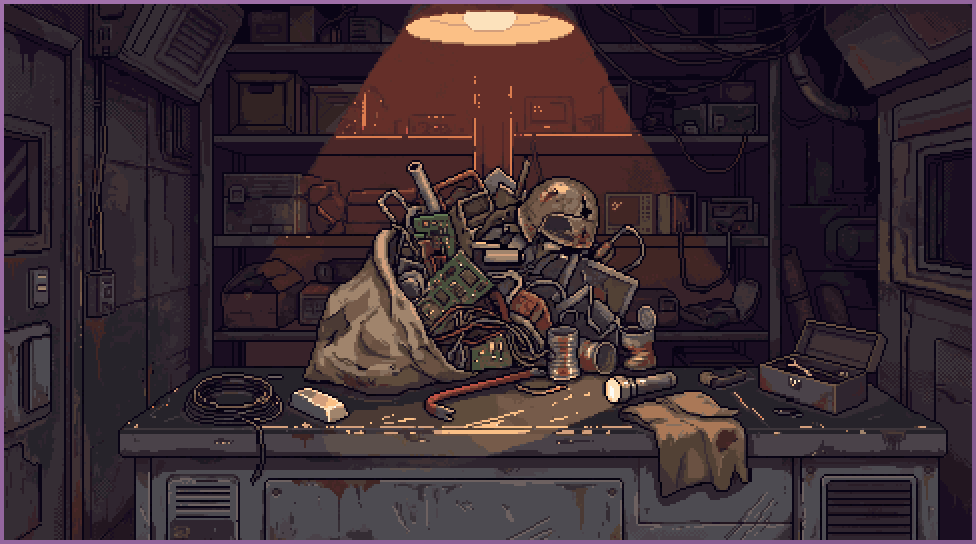

# Off the Books: Scavenging Pool

One trip to the dumping ground, the whole night's digging.

| | |
|---|---|
| Mod id | `rnk.scavenging-pool` |
| Version | 2.1.2 |
| Needs | Nothing. Counts Transit Quota's trips when that mod runs. |

## What you get

- **One pool:** the game gives fresh scavenging attempts every time you arrive. Here the attempts of all the night's trips go into one pool. Five attempts a trip and three trips make 15.
- **One visit:** spend them all at once and keep the other trips for trading.
- **No refills:** leave and come back the same night and the pool is where you left it. The next night starts fresh.
- **Bonuses count:** attempts from perks, events and other mods go into the pool as well.
- **Wounds:** the chance rises within each trip's worth of attempts and then starts over, like on separate visits.

## Options

In the Mods list and in Options, under **Off the Books: Scavenging Pool**. Automatic counting stops at four trips from the start. You can move that, set a fixed number of trips, or let wound chances keep rising through the whole pool.

## Good to know

- You get more finds in a night, so it shifts the balance a little.
- Works on its own. With [Transit Quota](https://steamcommunity.com/sharedfiles/filedetails/?id=3840077264) it counts that mod's trips.

The full player's guide is [dist/README.txt](dist/README.txt).

## Install

Subscribe on the Steam Workshop and Steam does the rest. Approve the mod and switch it on in the game's
Mods menu, then restart the game.

## Problems and ideas

Open an [issue](https://github.com/rnk-gaming/probably-stolen-mods/issues). That is where I keep track of things.
