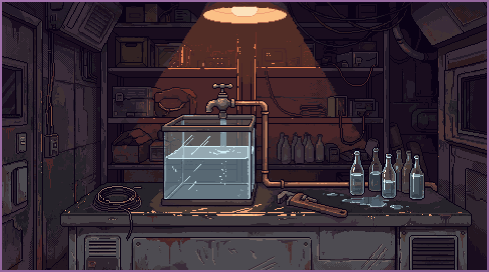

# Off the Books: Water Expanded Compatibility



Water Expanded on the shelves.

| | |
|---|---|
| Mod id | `rnk.shelf-compat` |
| Version | 1.1.4 |
| Needs | Water Expanded; Shop Expansion for the shelves. |

## What you get

- **On the shelves:** Water Expanded's faucet, pipes, tanks and bottler work on Shop Expansion's shelves.
- **In the back room:** they work there too.
- **Inside containers:** also when a device sits in a container that stands in one of those places.

## Options

In the Mods list and in Options, under **Off the Books: Water Expanded Compatibility**. One switch for the shelves and one for the back room. They take effect right away.

## Good to know

- It corrects one check in Water Expanded while the game runs. No files are changed and nothing is added to your save, so you can remove it whenever.
- Needs Water Expanded. The shelves part needs Shop Expansion too.

The full player's guide is [dist/README.txt](dist/README.txt).

## Install

Subscribe on the Steam Workshop, or copy the contents of `dist/` into a folder of its own under the
game's `Mods/` folder. Approve the mod and switch it on in the game's Mods menu, then restart the game.

## Build

```bash
dotnet build mods/ShelfCompat -c Release
```

The DLL lands in `bin/Release/netstandard2.1/`. The folder `dist/` holds the released build.

## Problems and ideas

Open an [issue](https://github.com/rnk-gaming/probably-stolen-mods/issues). That is where I keep track of things.
