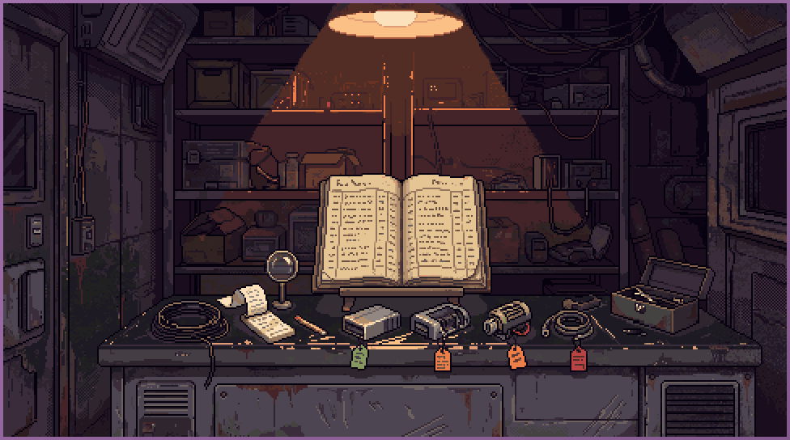

# Off the Books: Shopkeeping Suite

A bunch of small helpers for running the shop. Switch on the ones you like.

| | |
|---|---|
| Mod id | `rnk.shopkeeping-suite` |
| Version | 0.7.2 |
| Needs | Nothing. Reads Station Economy, Scrapyard Expansion and Module Forge when they run. |

## What you get

- **Marks on items:** a green square for what the customer wants and can afford, an orange one for what is over their budget, red and purple triangles for stolen goods and contraband on offer, a red diamond for what a search would find.
- **Price arrows:** green up for dearer than usual, red down for cheaper. One arrow from 5%, two from 20%, and the tooltip says why.
- **The ledger:** a window with four pages on F6. Today's sales, purchases and costs, the whole run, the customer at the counter, and your standing with every faction.
- **Standing:** changes show on the tablet as they happen.
- **Answers, if you want them:** the right appraisal value and what a counterfeit check would find.
- **Hands:** what you still hold after a night out is carried into storage at home.

## Options

In the Mods list and in Options, under **Off the Books: Shopkeeping Suite**. Every helper has its own switch, and you can change the key, the size of the marks and when the arrows show.

## Good to know

- Most of it only shows you things. Three helpers change what happens: the appraisal fill, the hands helper, and the one that rolls the certificate customer first.
- The ledger counts from the day you switch it on.
- Works on its own. It reads [Station Economy](https://steamcommunity.com/sharedfiles/filedetails/?id=3838352344), [Scrapyard Expansion](https://steamcommunity.com/sharedfiles/filedetails/?id=3840982832) and [Module Forge](https://steamcommunity.com/sharedfiles/filedetails/?id=3837427779) when you have them.

The full player's guide is [dist/README.txt](dist/README.txt).

## Install

Subscribe on the [Steam Workshop](https://steamcommunity.com/sharedfiles/filedetails/?id=3846399288) and Steam does the rest. Approve the mod and switch it on in the game's
Mods menu, then restart the game.

## Problems and ideas

Open an [issue](https://github.com/rnk-gaming/probably-stolen-mods/issues). That is where I keep track of things.
