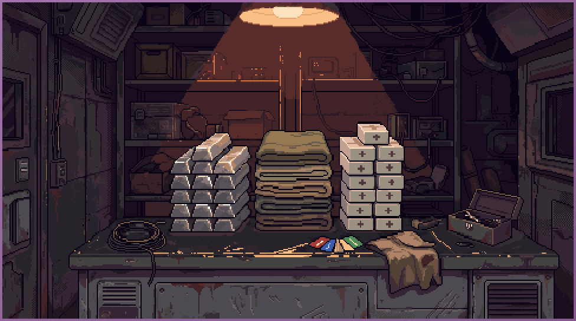

# Off the Books: Stacking

Stacks. Finally. Materials, medical items and key cards pile up in one slot.

| | |
|---|---|
| Mod id | `rnk.stacking` |
| Version | 1.9.2 |
| Needs | Nothing. Works with Station Economy and Faucet Filter when they run. |

## What you get

- **What stacks:** materials, medical items and key cards. The full list is below.
- **How many:** a limit for each kind of goods. From the start it is 20 for materials, 10 for medical items, food, household goods, substances and access cards, 50 for ammunition and 5 for everything else.
- **Where:** the shop and the back room, storage bays, smuggler's bays, machine bays, crates, what you carry on a night out, and backpacks that have the stack size upgrade.
- **Using a stack:** it sells and counts by its number. A machine takes what it needs, a lock takes one card, a request or a barter takes what it asks for and leaves the rest.
- **Splitting:** scroll while you drag.
- Clean and stolen goods stay apart, and so do different purities.

## What stacks

- **Materials:** Metal Ingot, Scrap Metal, Junk, Kotton Fabric, Metal Ore, Rare Metal Ore, Electronic Parts (Common, Rare, Hypertech), Wire, Printer Plastic, Gun Parts, Metal Screws, Chemical Supplies and Medical Supplies (Common, Restricted).
- **Medical:** the three bandages, Tilapia Skin Graft, pills, dusts, injectors, salve, rubbing alcohol, blood bags, smelling salt, ZeroChew and the surgery toolset.
- **Key cards.**
- **Your own picks:** add more items to the list in Options.

## Options

In the Mods list and in Options, under **Off the Books: Stacking**. Every limit can be set from 1 to 99, you choose where stacking is allowed, and you can add items of your own to the list.

## Good to know

- Split your stacks before you remove the mod. Without it a stack is one item.
- It works alone. With Station Economy it lets that mod do the stacking and adds its own places and limits. Faucet Filter is handled too.
- Please run one stacking mod at a time.

The full player's guide is [dist/README.txt](dist/README.txt).

## Install

Subscribe on the Steam Workshop and Steam does the rest. Approve the mod and switch it on in the game's
Mods menu, then restart the game.

## Problems and ideas

Open an [issue](https://github.com/rnk-gaming/probably-stolen-mods/issues). That is where I keep track of things.
