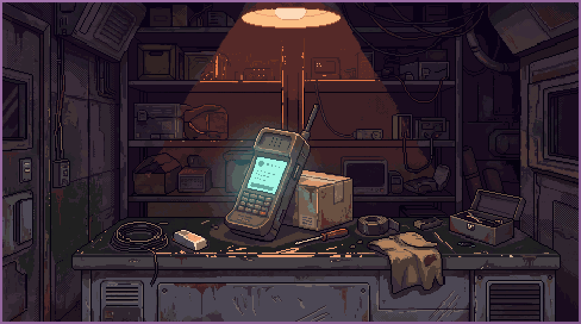

# Off the Books: Station Economy Compatibility



A handful of fixes for Station Economy, for those of us who play it in English or on a wide screen.

| | |
|---|---|
| Mod id | `rnk.station-economy-compat` |
| Version | 2.6.2 |
| Needs | Station Economy. |

## What you get

- **The phone on wide screens:** on a screen wider than 16:9 the phone (F7) shows up inside the picture, and you can drag it over the black sides.
- **Texts that fit:** a phone text that is too long gets smaller before it is cut.
- **More English:** about 7,600 lines for texts that were still in Chinese, and English that holds when your shopkeeper has a name of your own.
- **Previews and avatars:** message previews are cut after they are translated, and avatars show the first letter of the English name.
- **Hoppers:** they can fill the Furnace again.
- **Whole-lot offers:** a seller who says "half price" for the lot now charges less for it.

## Options

In the Mods list and in Options, under **Off the Books: Station Economy Compatibility**. Each fix has its own switch, and you can set how small a phone text may get.

## Good to know

- Nothing in Station Economy's files is touched. It all happens while the game runs, and nothing is written to your save.
- The whole-lot fix changes prices.
- To Station Economy's author: the English lines are in the mod folder in your own table format. Take whatever is useful.
- Needs Station Economy.

The full player's guide is [dist/README.txt](dist/README.txt).

## Install

Subscribe on the Steam Workshop, or copy the contents of `dist/` into a folder of its own under the
game's `Mods/` folder. Approve the mod and switch it on in the game's Mods menu, then restart the game.

## Build

```bash
dotnet build mods/StationEconomyCompat -c Release
```

The DLL lands in `bin/Release/netstandard2.1/`. The folder `dist/` holds the released build.

## Problems and ideas

Open an [issue](https://github.com/rnk-gaming/probably-stolen-mods/issues). That is where I keep track of things.
