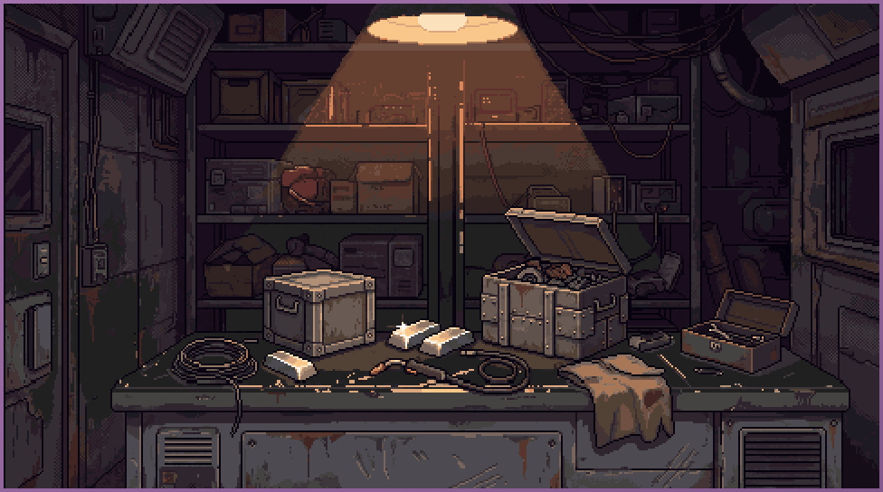

# Off the Books: Storage Upgrades

More room in the things you already own. Drop a Metal Ingot on a storage bay and it gets a column or a row.

| | |
|---|---|
| Mod id | `rnk.storage-upgrades` |
| Version | 1.3.4 |
| Needs | Nothing. |

## What you get

- **Bays:** every Metal Ingot adds one column or one row, up to a limit per bay. The sizes are below.
- **Loot crates:** drop an empty crate on another of the same kind. A 7x5 crate ends at 19x11, six crates in one.
- **Red Imp Beer Cases:** the same trick. Three wide first (24x4), and a second row (24x8) with the sixth case.
- **Machine storage:** the Fridge, Wine Rack, Aquaculture and Rat Cage take ingots once the game's own upgrades are done, and the Water Tank holds more.
- **Trade-in:** hand an enlarged Smuggler's Bay to the janitor and the modified one keeps what you added.

## How big it gets

- **Mini Smuggler's Bay:** 3x3 to 6x6.
- **Smuggler's Bay:** 5x5 to 10x10.
- **Smuggler's Bay (Modified):** 8x8 to 16x16.
- **Machine Bay:** 6x8 to 12x14.
- **Machine Bay (Expanded):** 11x14 to 20x20.
- **Storage Bay:** 10x10 to 16x16.
- **Storage Bay (Extended):** 17x10 to 20x20.
- **Gunsmith Storage Bay and Chemist Storage Bay:** 17x10 to 20x16.
- **Loot crates:** 7x5 to 19x11, six crates in one.
- **Red Imp Beer Case:** 8x4 to 24x8, six cases in one.
- **Fridge:** 9x13 and 7x13. **Wine Rack:** 12x8. **Aquaculture and Rat Cage:** 24x16.
- **Water Tank:** from 12 to 48, in six steps.

## Options

In the Mods list and in Options, under **Off the Books: Storage Upgrades**. You can cap how far each bay grows and how many crates one crate may swallow. Two switches that are off from the start let bays hold a Machine Bay.

## Good to know

- Sizes are saved on the containers. "Before removing this mod: list what to move" in Options shows what has to come out before you remove the mod.
- With a stacking mod, a whole stack of ingots upgrades as far as it reaches.
- Works on its own.

## Other mods

- **Compatible with** [Fence and Case Expansion](https://steamcommunity.com/sharedfiles/filedetails/?id=3837619429): its 8x8 crates grow too, three crates in one, up to 19x11.
- **Compatible with** a mod that stacks items ([Off the Books: Stacking](https://steamcommunity.com/sharedfiles/filedetails/?id=3846399246), or [Station Economy](https://steamcommunity.com/sharedfiles/filedetails/?id=3838352344)): a whole stack of ingots upgrades as far as it reaches.
- **Not compatible with** another mod that enlarges the same bays, crates or machine storage.
- Want to try it with another mod? Make a copy of your save first, and tell me on GitHub how it went.

The full player's guide is [dist/README.txt](dist/README.txt).

## Install

Subscribe on the [Steam Workshop](https://steamcommunity.com/sharedfiles/filedetails/?id=3846399152) and Steam does the rest. Approve the mod and switch it on in the game's
Mods menu, then restart the game.

## Problems and ideas

Open an [issue](https://github.com/rnk-gaming/probably-stolen-mods/issues). That is where I keep track of things.
